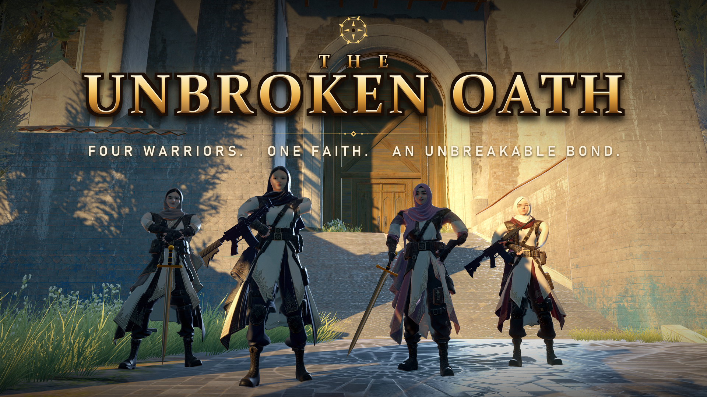
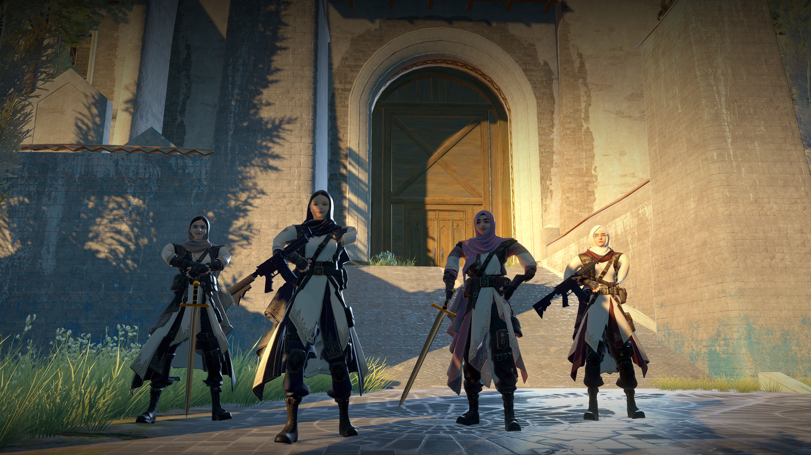

<p align="center">
  
</p>

<p align="center">
  
  
  
  
</p>

# The Unbroken Oath

**A first-person tactical rescue shooter.** Four warriors. One faith. An unbreakable bond.

Three members of your squad were taken in the night and are held inside a temple, in three separate rooms behind
locked doors. You are the only one left. Fight through the enemy, free each captive, and bring them home. *The oath
will not be broken.*

<p align="center">
  
</p>

## The mission: Operation Sun Temple

1. **Briefing.** An operator speaks to you (with a dialogue box and voice) and explains the inventory, the map and the
   mission. Press `Space` to skip.
2. **Fight through the temple** in the morning light. Enemy soldiers patrol the grounds; the minimap shows them as red
   dots, and gold diamonds mark where your teammates are held.
3. **Free a captive.** Walk up to a kneeling teammate and press `E`. A rescue cutscene plays: the ropes fall away,
   she stands and thanks you.
4. **Night falls.** After the first rescue the game shifts from clear morning to **night with rain, fog, thunder and
   lightning**, and the fires and torches light up. The second and third rescues happen in the storm.
5. **Win or fail.** Free all three teammates for the **victory cutscene** and the *Mission Complete* screen. If you
   die, a **death cutscene** plays, then the *Mission Failed* screen shows who you rescued and who is still captive.
   Press `Enter` to try again.

## Features

- **Three weapons and grenades:** rifle, pistol and sniper on `1` `2` `3`. Hold `G` to pull the pin and "cook" a
  fragmentation grenade, with a dotted throw arc and a red ring that shows the lethal radius.
- **Tactical HUD:** ammo panel with fire mode, magazine count, reserve, cartridge row, LOW AMMO warning and reload
  prompt; weapon box; life bar with damage trail, red edge flashes and a low-health pulse.
- **Minimap and full map (`M`):** rotating minimap with the player arrow, red enemy dots, gold rescue-room diamonds and
  green medical-kit markers.
- **Operator voice assistant:** radio callouts ("Reloading", "Unlocking door", "Rescuing teammate", "Enemy spotted")
  with on-screen subtitles and a cooldown so it never spams.
- **Dynamic weather and time of day:** morning to night transition, procedural rain, lightning with delayed thunder.
- **Torch (`F`):** hand-held torch with a spotlight, glow, flame effect and sound.
- **Cinematics:** animated main menu where the squad walks into the gate plaza and strikes hero poses, a story intro
  (text or video), a rescue cutscene, a victory cutscene and a death cutscene, built with procedural bone animation.
- **Blood and combat effects:** directional hit sprays, floor and wall splatters, growing blood pools.
- **Menus and settings:** animated buttons, settings and controls panels, master and music volume saved between
  sessions, scene fade transitions.
- **Performance defaults:** VSync, shadow distance and terrain detail tuned automatically at startup.

## Controls

| Action | Key |
| --- | --- |
| Move / look / shoot | `W` `A` `S` `D` / mouse / left mouse button (full-body FPS controller) |
| Select weapon | `1` rifle, `2` pistol, `3` sniper |
| Throw grenade | Hold `G`, release to throw |
| Interact (doors, free a teammate) | `E` |
| Torch on / off | `F` |
| Full map | `M` |
| Skip briefing / intro | `Space` (`Enter` / `Esc` also skip the intro) |
| Try again after failing | `Enter` |

## Play it

A packaged Windows build is available from the repository's **Releases** page (download the zip, extract it, and run
**`TheUnbrokenOath.exe`**). Run the `.exe` from the extracted folder.

## Open the project in Unity

1. Install **Unity 2022.3.62f2** (Unity Hub -> Installs).
2. Clone this repository and add the folder in Unity Hub. The Package Manager restores the Unity packages (including
   Post Processing 3.0.3) from `Packages/manifest.json`.
3. This repository contains the game's own **code, editor tools, scenes and settings**. The third-party environment
   packs, weapon and character models, and audio are **not** included (see
   [Credits](#credits-and-third-party-assets)). Import them into `Assets/` first, then open
   `Assets/Scenes/MainMenu.unity`. Until then the scenes will show missing references.
4. Build order: `MainMenu` -> `StoryScene` -> `SunTemple_Night` -> `SunTemple_Game`.

## Project structure

```
The-Unbroken-Oath/
├── Assets/
│   ├── Scripts/
│   │   ├── Combat/    Grenades, explosions, ammo and weapon HUD
│   │   ├── FX/        Blood hit, splatter and pool effects
│   │   ├── Menu/      Main menu director, buttons, panels, story intro, scene transitions, settings
│   │   ├── Mission/   Mission manager, briefing, hostages, minimap, rescue / victory / death cutscenes, fail screen
│   │   ├── Player/    Health UI and torch
│   │   ├── Voice/     Operator voice assistant and dialogue box
│   │   └── Weather/   Day-night cycle, storm, flickering lights
│   ├── Editor/        "GAMECON" editor menu: builders that generate the HUD, menu, mission, weather, cutscenes and Windows build
│   └── Scenes/        MainMenu, StoryScene, SunTemple_Night, SunTemple_Game, Combined_Scene
├── Packages/          Unity package manifest
├── ProjectSettings/
├── RescueDoor.json    Level-design data: the door of the rescue room
└── docs/              Key art
```

### Notable systems

| System | Script(s) | What it does |
| --- | --- | --- |
| Mission flow | `MissionManager`, `MissionBriefing`, `Hostage` | Objective, prompts, rescue counting, briefing, win and fail states |
| Cutscenes | `CutsceneDirector`, `VictoryCutscene`, `DeathCutscene`, `CaptiveRig`, `HeroRig`, `DeathRig` | Camera work and procedural bone poses for rescue, victory and death scenes |
| Weather | `DayNightController`, `StormController` | Morning-to-night shift, rain, fog, lightning and thunder |
| Combat | `GrenadeThrower`, `Grenade`, `ExplosionFX`, `AmmoHud`, `WeaponHud` | Cookable grenades, lethal radius, weapon and ammo UI |
| Navigation | `MinimapController`, `RescueDoorMarker` | Minimap and full map, rescue-room marker |
| Voice | `VoiceAssistant`, `DialogueBox` | Radio callouts with subtitles; speech-bubble dialogue with portrait |
| Menu | `MainMenuDirector`, `MenuHero`, `MenuButton`, `StoryIntro`, `SceneTransition` | Animated main menu, story intro, transitions |

## Built with

- **Unity 2022.3 LTS**, C#, Post Processing Stack v2, Video Player, UGUI
- Procedural animation, in-editor scene builders and a custom build script

## Status

A playable prototype (version 0.1). Some editor-side helpers are developer tools (for example `BuildSelfTest` and the
`F10` rescue-door marker) and are not part of normal play.

## Credits and third-party assets

The game uses assets made by other people. None of them are included in this repository, and each one stays under its
publisher's own license:

- **Environment:** Flooded Grounds and Sun Temple packs
- **Character controller and weapon models:** Full Body FPS Controller package (`scgFullBodyController`)
- **Character models:** generated with Meshy AI
- **Fonts:** Rajdhani (SIL Open Font License)
- **Unity packages:** Post Processing Stack v2
- Sound effects, music and voice clips

If you are the publisher of one of these and would like the credit changed, please open an issue.

---

Repository maintained by [@zubiajunaid954-bot](https://github.com/zubiajunaid954-bot).
